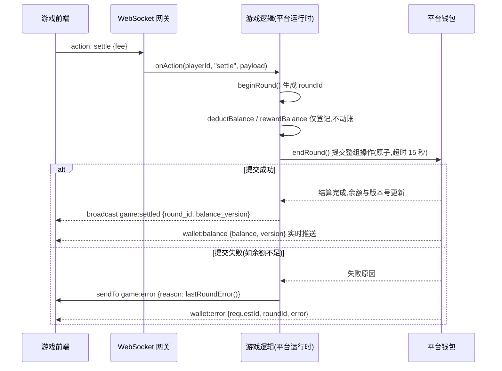

# 资金接入

## 回合模型

一切资金变动必须包裹在显式回合中。平台不会隐式创建回合,无活跃回合时扣款与奖励登记返回 false,且不产生任何流水。

```text
游戏前端 ──动作: settle {fee:100}──▶ 游戏逻辑
   beginRound 得到回合 ID
   deductBalance 扣除 100
   按玩法规则计算奖励
   rewardBalance 发放奖励
   endRound 提交 ──▶ 平台钱包,整回合原子生效 ──▶ 余额推送 wallet:balance
游戏逻辑 ──广播 game:settled {roundId, balanceVersion}──▶ 游戏前端
```

标准代码模式:

```typescript
onAction(playerId: string, action: string, payload: any) {
  if (action !== 'settle') return
  const roundId = platform.beginRound()
  if (!roundId) return                    // 已有未闭合回合,忽略本次
  let committed = false
  try {
    platform.deductBalance(playerId, payload.fee, `settle ${roundId}`)
    const prize = this.rewardOf(playerId) // 按玩法规则计算奖励,使用公平随机
    if (prize > 0) platform.rewardBalance(playerId, prize, 'settle reward')
    platform.recordResult(playerId, prize > payload.fee ? 'win' : 'lose',
                          prize - payload.fee)          // 登记对局记录
  } finally {
    committed = platform.endRound()       // 无论中途何种分支,回合必须闭合
  }
  if (!committed) {
    // 提交失败:读取失败原因,向玩家说明,并回滚本局状态
    platform.sendTo(playerId, 'game:error', { reason: platform.lastRoundError() })
    return
  }
  platform.broadcast('game:settled', {
    player_id: playerId,
    round_id: roundId,
    balance_version: platform.getBalanceVersion(playerId),
  })
}
```

完整结算链路:



规则:

- 必须遵循 beginRound、登记、endRound 的顺序。endRound 返回 true 之前,不得视任何扣款与奖励为生效。
- 必须处理 endRound 返回 false 的分支:读取 lastRoundError,恢复对局前状态,并让玩家知晓。
- 金额为 64 位整数金币。小数会被静默截断,NaN、Infinity 与非正数直接拒绝。禁止依赖超过 2 的 53 次方的数值,那是 JS 的精度边界。
- 一个引擎同一时刻只允许一个活跃回合。批量结算类玩法在一回合内逐人登记即可。
- 回合提交为整组原子:任一操作失败,整回合全部回滚,并逐操作下发 wallet:error。设计玩法时避免跨回合的半结算状态。

## 幂等与安全

- 玩家动作重复发送时,平台按玩家与动作序号去重,动作内产生的资金操作自动幂等,不会重复记账。
- 回合 ID 只能由 beginRound 在服务端生成。禁止接受前端载荷中的任何回合标识作为结算依据。
- 全部回合操作落审计账,含回合表与逐操作表,可供平台回溯与对局回放,每回合最多录制 500 条广播事件。

## 余额显示

游戏内余额显示的唯一权威是平台的 `wallet:balance` 版本化推送,配合结算结果中的版本号使用:

1. 收到 `wallet:balance` 时,仅当 version 大于本地水位才更新显示并抬高水位。
2. 收到结算结果时,应用结果携带的 balance_version,将水位至少抬到该值,丢弃此前积压的旧推送。
3. 页面恢复可见或重连后,调用 `client.sync()` 拉取权威快照对账。

禁止轮询余额接口,平台推送链路已覆盖对局、充值、平台发放、管理调账等全部余额变更来源。

`platform.getBalance()` 返回引擎本地缓存,可能滞后于权威值。必须将其用于展示与体验优化,禁止用于扣款前预检。余额不足应在 endRound 之后经 lastRoundError 统一处理,平台结算时的校验才是权威。

## 公平随机

涉及随机结果的玩法,例如洗牌、随机事件判定,必须使用平台的 commit-reveal 公平随机接口,使玩家可以独立验证随机过程未被篡改:

```typescript
const seedId = 'fair:' + roundId
const commitment = platform.beginFairRound(seedId)   // 先广播承诺,再消费任何随机数
if (!commitment) { /* 熵源失败,取消本局 */ }

const point = Math.floor(platform.getFairRandom(seedId, 0) * DECK_SIZE)
// … 按玩法规则结算 …
platform.revealFairRound(seedId)                     // 揭示种子,玩家可复算
```

验证算法,玩家侧可完整复算:

- 承诺值为 `SHA-256("fair-seed:" + seed)` 的十六进制串。
- 派生随机数取 `SHA-256(seed + ":" + index)` 结果的前 53 位除以 2 的 53 次方,得到 0 到 1 左闭右开区间上的均匀分布。同一 seedId 可派生多次独立抽取。
- 时序要求:必须在消费任何随机数之前调用 beginFairRound,承诺先行;结算完成后、回合闭合前调用 revealFairRound。
- 每个引擎实例最多保存 64 个未揭示种子,先进先出淘汰。建议一回合一种子,用后即揭示。

## RTP 申报与漂移核查

依赖随机结果的玩法,提审时应通过 `rtpDeclared`(期望回报率,两位小数,如 95.00)与 `rakeRateDeclared`(平台抽成)申报玩法参数,字段说明见[提交与审核](review.md)。

平台每日核对实际运行数据与申报值,满足以下全部条件时自动创建风控案件并进入平台核查流程,同一游戏已有未处理案件时不重复创建:

| 条件 | 阈值 |
| --- | --- |
| 总投注 | ≥ 100000 金币 |
| 结算回合数 | ≥ 100 |
| 实际 RTP 与申报值偏差 | > 2 个百分点 |

请确保申报值与真实玩法参数一致;调整玩法回报参数后,新版本提审时应同步更新申报值。
