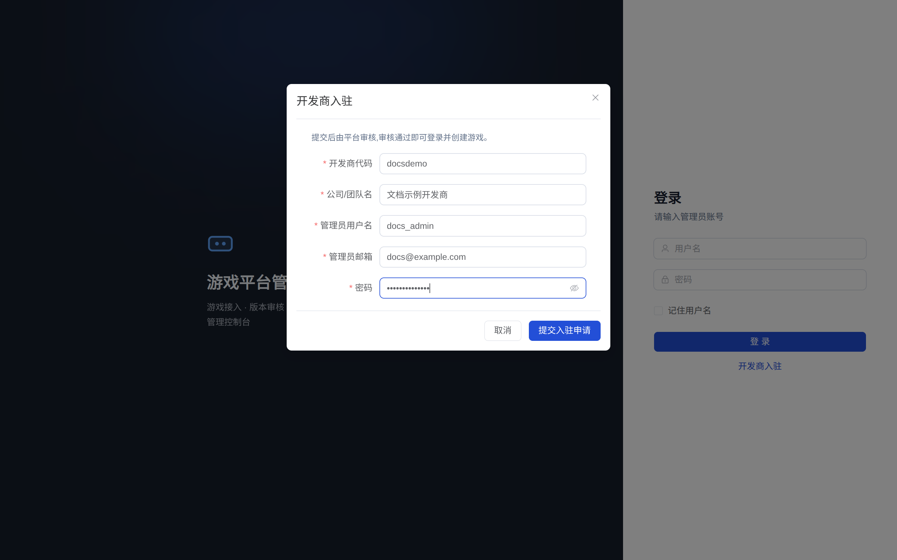
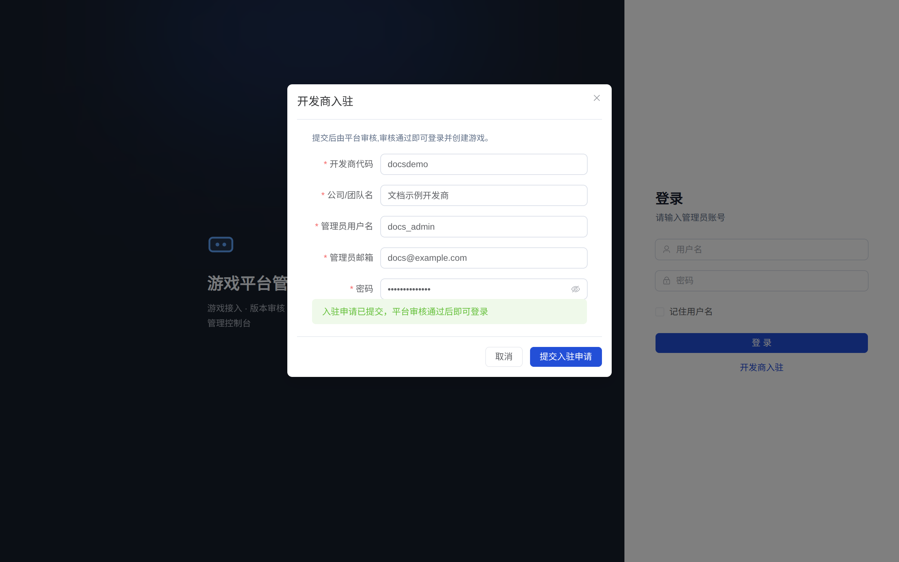
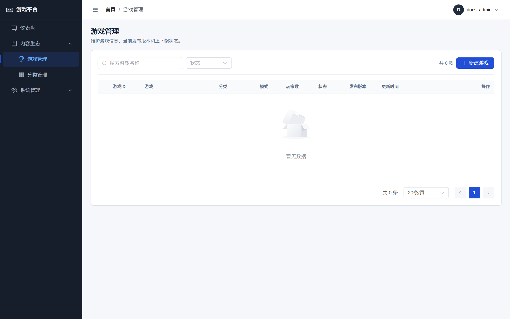
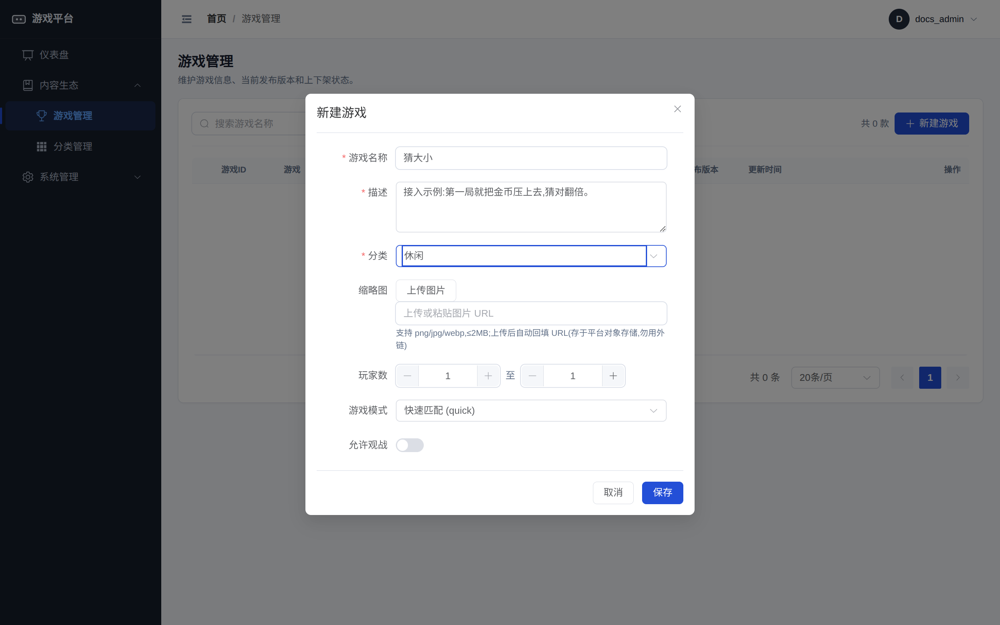
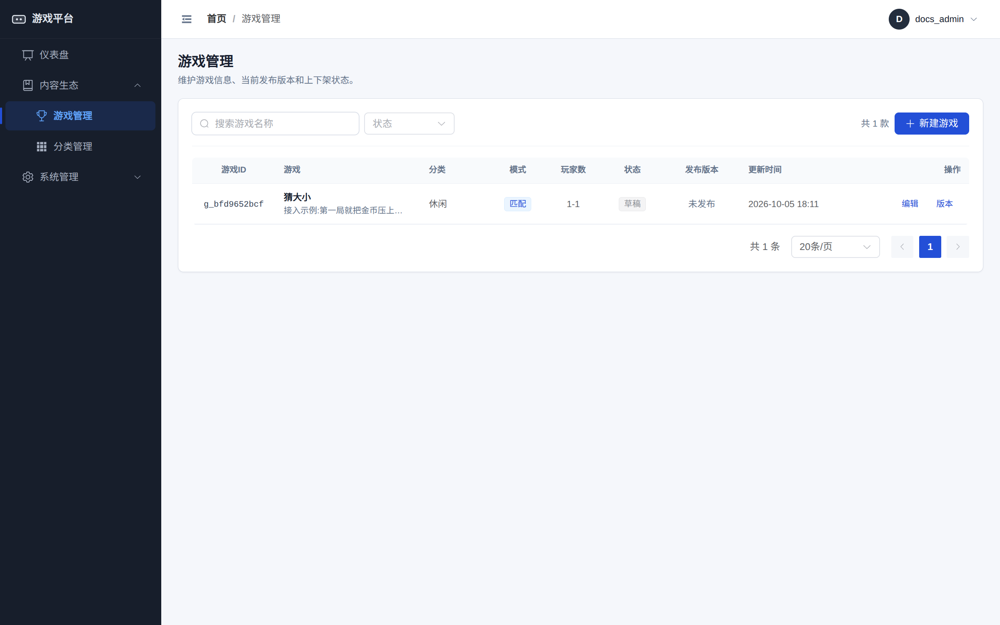

# 入驻与创建游戏

入驻与创建游戏全部在管理后台完成,无需调用任何接口。后台地址:[game.zihua-chen.cn/admin](https://game.zihua-chen.cn/admin/)。

## 第一步:提交入驻申请

打开后台登录页,点击左下角"开发商入驻"。

在弹出的表单中填写:

| 字段 | 要求 |
| --- | --- |
| 开发商代码 | 2–30 位字母或数字,全局唯一,如 `pixelfun` |
| 公司/团队名 | 不超过 100 字符,展示给平台运营 |
| 管理员用户名 | 3–50 位,入驻通过后用它登录后台 |
| 管理员邮箱 | 联系邮箱 |
| 密码 | 至少 6 位 |

提交后提示"入驻申请已提交,平台审核通过后即可登录":

代码、用户名或邮箱重复会在表单上直接提示,换一个再提交即可。

## 第二步:等待平台激活

入驻申请由平台运营在"开发商管理"中审核。激活前登录会被拒绝(错误码 403104/403301),激活后即可用管理员用户名和密码在登录页登录。开发商被平台停用后的表现相同,直至重新激活。

登录后的账号能力边界:

- 只能创建、修改、提审本开发商名下的游戏,越权返回 403。
- 玩家管理、全量游戏列表、包审核与游戏上下架属平台职能,开发商无权限。

## 第三步:创建游戏

登录后进入 内容生态 → 游戏管理,点击"新建游戏"。

按表单填写:

| 字段 | 要求 |
| --- | --- |
| 游戏名称 | 必填,不超过 255 字符,同一开发商内唯一 |
| 描述 | 必填,不超过 5000 字符,展示在大厅 |
| 分类 | 平台预设分类,下拉选择,如休闲、竞技、棋牌 |
| 缩略图 | 选填。上传 png/jpg/webp(不超过 2 MB),存储在平台对象存储并自动回填站内 URL;外站图片 URL 会被后台校验拒绝(大厅 CSP 仅放行站内图片) |
| 玩家数 | 最小到最大,1–100,最小不大于最大 |
| 游戏模式 | 快速匹配(quick)或房间(room) |
| 允许观战 | 是否开启会话级只读观战 |

会话模式选择:

| 模式 | 行为 | 适用 |
| --- | --- | --- |
| quick | 玩家点击开始后进入平台匹配队列,会话人数达到 minPlayer 即自动就绪并开局 | 对战、牌桌类 |
| room | 房主创建房间获得 6 位房间码,其他玩家凭码加入等待室,房主满足人数后开局 | 好友邀请、私密局 |

平台只在人数达到 minPlayer 时自动开局,人数不足时的补位或托管策略由游戏逻辑自行实现。除特殊玩法外建议 minPlayer 与 maxPlayer 相等,开局人数最确定、等待最短。

保存后列表出现新游戏,状态为"草稿"、未发布,并分配游戏 ID:

游戏 ID 后续提审与版本管理都会用到,在列表第一列查看。此时游戏尚未上架,下一步是开发双端产物并提交第一个版本,见[快速开始](quick-start.md)与[提交与审核](review.md)。
