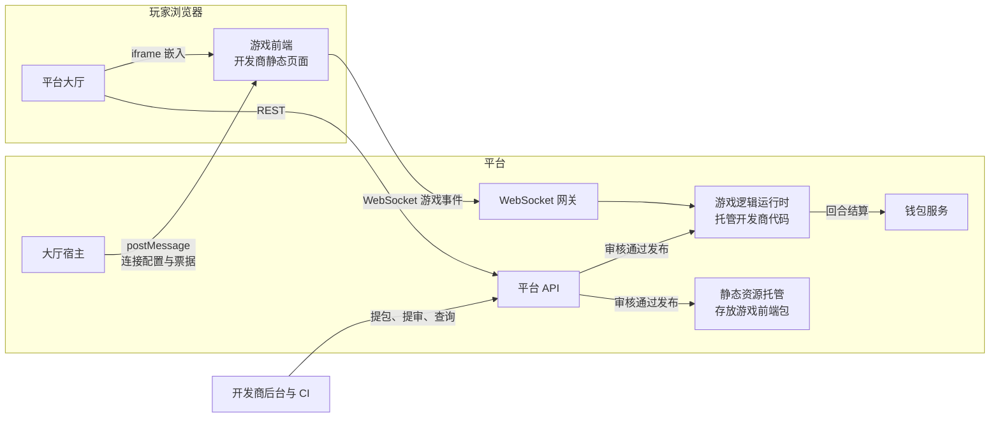

# 接入总览

本指南面向游戏开发商,说明如何将一款游戏接入本平台,并获得分发、联机、匹配与结算能力。接入完成后,玩家在大厅内即可发现、进入并游玩你的游戏。

建议阅读顺序:先读本章建立整体认知,再按[快速开始](quick-start.md)跑通第一个版本,其余章节按需查阅。

## 文档约定

- 必须:强制要求,不满足将无法通过审核或无法正常运行。
- 禁止:强制禁止,违反将导致提审被拒或运行被终止。
- 建议:推荐做法,平台以此为准设计,偏离需自行承担兼容风险。

## 平台能力

| 能力 | 说明 |
| --- | --- |
| 游戏分发 | 游戏上架后进入大厅游戏列表,支持分类、搜索、收藏与最近游玩 |
| 联机对战 | 平台提供 WebSocket 网关、会话管理、断线重连与在线状态 |
| 匹配系统 | quick 模式下平台自动撮合玩家并开局 |
| 房间系统 | room 模式下平台提供房间创建、房间码加入与等待室长轮询 |
| 观战 | 会话级只读观战,需游戏声明允许 |
| 托管结算 | 平台托管玩家余额,提供回合级原子结算、流水审计与实时余额推送 |
| 对局记录 | 游戏上报胜负结果后,玩家可在个人中心查看对局记录 |
| 公平随机 | 提供 commit-reveal 公平随机协议,玩家可独立验证随机结果 |
| 内容审核 | 前端包与游戏逻辑包版本化提审,审核通过即发布,支持版本回滚 |

## 你要开发什么

接入本平台不需要自建服务器、域名与运维。一款游戏由两部分产物组成,均由你开发、平台托管运行:

| 产物 | 形态 | 上限 |
| --- | --- | --- |
| 游戏逻辑包 | 单文件 JavaScript bundle(IIFE),承载全部权威玩法与结算 | 512 KiB |
| 游戏前端包 | 纯静态 Web 资源 zip,根目录含 index.html,以 iframe 嵌入大厅 | zip ≤ 25 MB |

职责划分:

| 由你负责 | 由平台负责 |
| --- | --- |
| 玩法规则与游戏逻辑 | 账号注册登录与身份凭证 |
| 前端界面与交互表现 | 钱包、余额、流水与回合结算 |
| 回合内扣款与奖励的调用时机 | WebSocket 网关、会话状态机、断线重连 |
| 游戏自定义事件的定义与处理 | 匹配、房间、观战 |
| 对局胜负结果上报 | 公平随机基础设施 |
| 版本迭代与提审 | 内容审核、发布、回滚与分发 |

游戏逻辑运行在平台的隔离运行时中,不暴露任何网络接口,玩家无法绕过前端直接访问;游戏前端永远不持有玩家长期凭证,只通过一次性票据连接。

## 适合什么游戏

| 评估 | 类型 | 说明 |
| --- | --- | --- |
| 官方支持 | 牌桌、棋类、老虎机、休闲对战等回合制或会话制玩法 | 平台的会话模型(最长 2 小时)与回合结算即为这类玩法设计 |
| 可能接入 | 其他能满足运行约束的浏览器玩法 | 逻辑包 ≤ 512 KiB 且无外部依赖、单次回调 ≤ 2 秒、消息帧 ≤ 64 KiB;前端框架任意,能产出纯静态包即可 |
| 不支持 | 需要自建游戏服务器或访问外部网络与第三方 API 的玩法 | 逻辑运行时无任何网络能力,禁止 fetch、XMLHttpRequest、WebSocket |
| 不支持 | 原生客户端与需要分发安装包的游戏 | 平台只承载浏览器内运行的游戏 |
| 不支持 | 单局时长超过 2 小时的大型持久玩法 | 会话最长存活 2 小时,超时进入终态 |

## 接入架构



设计原则:

1. **凭证不进游戏前端**:游戏前端通过宿主协议向大厅索取一次性 WebSocket 票据,票据单次有效、30 秒过期。
2. **权威在服务端**:影响玩法与资金的操作均由游戏逻辑裁决,前端只负责表现。
3. **资金平台托管**:游戏逻辑只能通过平台回合接口发起扣款与奖励,结算原子完成并全程留痕。

## 接入流程

```text
注册开发商账号 → 平台资质审核 → 登录开发商后台
  → 创建游戏,录入基础信息与联机参数
  → 开发游戏前端与游戏逻辑 → 本地自检自测
  → 提审,上传前端包并提交游戏逻辑包
  → 平台审核 ──驳回──▶ 按意见修改后重新提审
       └──通过──▶ 自动发布上架 → 版本迭代
```

| 阶段 | 责任方 | 说明 |
| --- | --- | --- |
| 入驻审核 | 平台 | 开发商注册后为待激活状态,资质审核通过后开通登录 |
| 创建游戏 | 开发商 | 后台录入游戏基础信息与联机参数 |
| 开发自测 | 开发商 | 使用双 SDK 开发,按自检清单完成本地自测 |
| 包审核 | 平台 | 对前端包与游戏逻辑包做安全与合规审核,首个版本通过即自动上架 |
| 版本发布 | 平台 | 审核通过立即全量发布,线上问题可回滚至任一已过审版本 |

## 接入复杂度评估

| 项 | 评估 |
| --- | --- |
| 接入难度 | 中低:无需服务端开发与运维,核心工作是两份纯前端向产物 |
| 必须开发 | 游戏逻辑 bundle(生命周期钩子 + 回合结算)、游戏前端静态包(接入前端 SDK) |
| 可选开发 | 离席托管与 AI 补位、观战视图、对局结果上报(建议实现) |
| 平台提供 | 账号、钱包、结算、匹配、房间、观战、网关与重连、公平随机、审核发布与分发 |
| 最小 Demo | 约 0.5–1 人日:单一玩法动作 + 一次回合结算,参照[快速开始](quick-start.md) |
| 完整休闲对战 | 约 3–5 人日:牌桌或棋类完整规则、多人结算、断线托管 |
| 联调与提审 | 另预留 1–2 人日,含一轮驳回修改 |

以上估算以熟悉 TypeScript 与 WebSocket 的开发者为前提,不含玩法设计与美术资源工作量。
