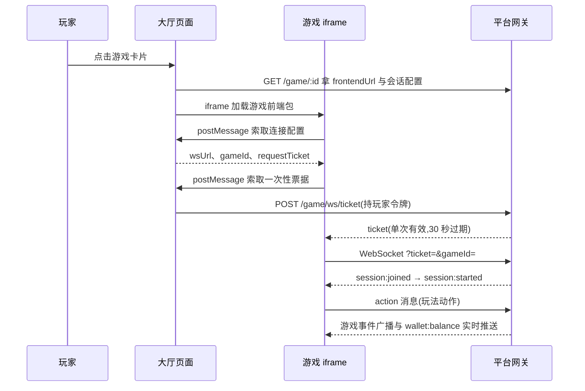

# 快速开始

本章给出从零接入的最短路径:写一个最小的双人都不需要的"猜大小"单机小游戏,走完 构建 → 入驻 → 创建游戏 → 提审 → 上架 的全链路。完成后你就掌握了接入所需的全部关键动作,之后把最小游戏替换成你的真实玩法即可。

预计耗时:纯开发约 0.5–1 人日;线上全链路(含平台入驻与包审核时效)准备充分时当天可完成。

## Step 0 准备环境

- Node.js 20 LTS 或更高版本,自带 npm。
- 从[SDK 下载](sdk-download.md)获取双 SDK 源码包,解压备用:

```text
my-game/
├── sdks/
│   ├── game-backend-sdk/    游戏逻辑 SDK
│   └── game-frontend-sdk/   游戏前端 SDK
├── backend/                 游戏逻辑工程(本页 Step 1)
└── frontend/                游戏前端工程(本页 Step 2)
```

## Step 1 最小游戏逻辑

游戏逻辑是一份 TypeScript 工程,构建为单文件 IIFE bundle 提交。新建 `backend/` 工程,`package.json` 以 `file:` 协议引用 SDK:

```json
{
  "name": "hilo-backend",
  "private": true,
  "scripts": { "build": "vite build" },
  "dependencies": {
    "@game-platform/backend-sdk": "file:../sdks/game-backend-sdk"
  },
  "devDependencies": { "typescript": "^5.0.0", "vite": "^5.0.0" }
}
```

`vite.config.ts`,产物为单文件 IIFE:

```typescript
import { defineConfig } from 'vite'

export default defineConfig({
  build: {
    target: 'es2015',
    minify: false,
    lib: { entry: 'src/game.ts', name: 'Game', formats: ['iife'], fileName: () => 'game.js' },
  },
})
```

`src/game.ts`,全部玩法逻辑——扣一次底注,用公平随机掷一个 1–100 的点数,猜对翻倍:

```typescript
import { GameLifecycle, registerGame } from '@game-platform/backend-sdk'

class HiLoGame extends GameLifecycle {
  // 会话就绪:广播规则快照,观战者与后进入者也能重建画面
  onInit() {
    platform.broadcast('hilo:init', { min_bet: 1, max_bet: 100 })
  }

  // 状态对账:首次进入、断线重连、页面恢复可见都会触发,必须实现
  onSync(playerId: string) {
    platform.sendTo(playerId, 'hilo:sync', {
      players: platform.getPlayers().map(p => p.id),
    })
  }

  onAction(playerId: string, action: string, payload: any) {
    if (action !== 'play') return
    const bet = Math.floor(Number(payload.bet) || 0)
    if (bet < 1) return
    const guess = payload.guess === 'hi' ? 'hi' : 'lo'

    const roundId = platform.beginRound()
    if (!roundId) return                 // 已有未闭合回合,忽略本次
    let roll = 0
    let committed = false
    try {
      platform.deductBalance(playerId, bet, 'hilo bet')
      const seedId = 'fair:' + roundId
      if (!platform.beginFairRound(seedId)) return
      roll = Math.floor(platform.getFairRandom(seedId, 0) * 100) + 1
      const win = guess === 'hi' ? roll > 50 : roll <= 50
      if (win) platform.rewardBalance(playerId, bet * 2, 'hilo payout')
      platform.revealFairRound(seedId)
      platform.recordResult(playerId, win ? 'win' : 'lose', win ? bet : -bet)
    } finally {
      committed = platform.endRound()   // 无论成败,回合必须闭合
    }
    if (!committed) {
      platform.sendTo(playerId, 'hilo:error', { reason: platform.lastRoundError() })
      return
    }
    platform.broadcast('hilo:result', {
      player_id: playerId,
      roll,
      round_id: roundId,
      balance_version: platform.getBalanceVersion(playerId),
    })
  }
}

registerGame(new HiLoGame())
```

构建:

```bash
cd backend && npm install && npm run build
# 产物 dist/game.js 即"游戏逻辑包"全文
```

## Step 2 最小游戏前端

游戏前端是常规 Web 工程,任意框架或纯 JS 均可,产物为纯静态资源。以最简的纯 TypeScript 页面为例,`frontend/src/main.ts`:

```typescript
import { GameClient, GameLifecycle, requestHostGameConfig, notifyGameExit } from '@game-platform/frontend-sdk'

let client: GameClient

class HiLoView extends GameLifecycle {
  onSessionJoin() { client.ready() }              // quick 模式:就绪后等待平台开局
  onStart() { setHint('对局开始,选择大或小') }
  onEvent(action: string, payload: any) {
    if (action === 'hilo:result') showResult(payload.roll)
    if (action === 'wallet:balance') setBalance(payload.balance)   // 实际实现需按 version 单调守卫
  }
  onError(err: string) { setHint('出错:' + err) }
}

// 1. 向大厅宿主索取连接配置(身份由宿主持有,游戏前端不接触玩家凭证)
const config = await requestHostGameConfig()

// 2. 连接平台 WebSocket,SDK 每次连接与重连自动向宿主索取一次性票据
client = new GameClient({
  url: config.wsUrl,
  gameId: config.gameId,
  ticketProvider: config.requestTicket,
})
client.use(new HiLoView())
await client.connect()

// 3. 发送玩法动作
document.querySelector('#hi')!.addEventListener('click', () => {
  client.sendAction('play', { bet: 10, guess: 'hi' })
})

// 4. 游戏内返回按钮:通知大厅返回,禁止自行实现跳转
document.querySelector('#exit')!.addEventListener('click', () => notifyGameExit())
```

`index.html` 提供按钮与结果显示的骨架即可。构建并打包 zip(根目录必须包含 index.html):

```bash
cd frontend && npm install && npm run build
cd dist && zip -r ../dist.zip .
# dist.zip 即"游戏前端包"
```

前端工程要求与更多细节见[游戏前端开发](game-frontend.md)。

## Step 3 注册开发商账号

打开后台登录页 [game.zihua-chen.cn/admin](https://game.zihua-chen.cn/admin/),点击"开发商入驻",填写开发商代码、公司/团队名、管理员账号与密码后提交,等待平台激活账号。图文步骤见[入驻与创建游戏](onboarding.md)。

## Step 4 创建游戏

用激活后的管理员账号登录后台,进入 内容生态 → 游戏管理 → 新建游戏:

- 游戏名称:猜大小;描述随意填写
- 分类任选(如休闲),缩略图可留空
- 玩家数 1 至 1(单机玩法),游戏模式选快速匹配(quick),观战关闭

保存后游戏出现在列表中,状态为草稿。记下列表第一列的**游戏 ID**(形如 `g_bfd9652bcf`),后续上传与提审都以它为标识。表单字段说明见[入驻与创建游戏](onboarding.md)。

## Step 5 提审

在后台操作:游戏管理 → 对应游戏行的"版本"按钮进入游戏版本页,上传前端包 dist.zip 与后端 dist/game.js、填写版本号后提交,表单用法见[提交与审核](review.md)。

依赖随机结果的玩法应在提审时申报 `rtpDeclared`(期望回报率)与 `rakeRateDeclared`(平台抽成),本例胜负各半、猜对得双倍,回报率为 100.00。平台按申报值做漂移监控,见[资金接入](funds.md)。需要脚本化提审(如接入 CI)时,上传与提交的接口定义同样见[提交与审核](review.md)。

## Step 6 过审上架

提审后版本进入 `pending_review`。平台审核通过即自动发布:游戏转为 approved、出现在大厅列表,无需另行上架操作。驳回原因在包记录的 `reviewComment` 字段返回,修改后重新提审即可。

至此第一个游戏上线。玩家进入游戏时的完整链路如下:



## 下一步

- 换成你的真实玩法:[游戏逻辑开发](game-backend.md)、[游戏前端开发](game-frontend.md)
- 涉及资金与随机的完整规则:[资金接入](funds.md)
- 协议与消息格式细节:[事件与协议规范](protocol.md)
- 提审前自检:[本地开发与自测](local-dev.md)、[平台限制与接入清单](limits.md)
