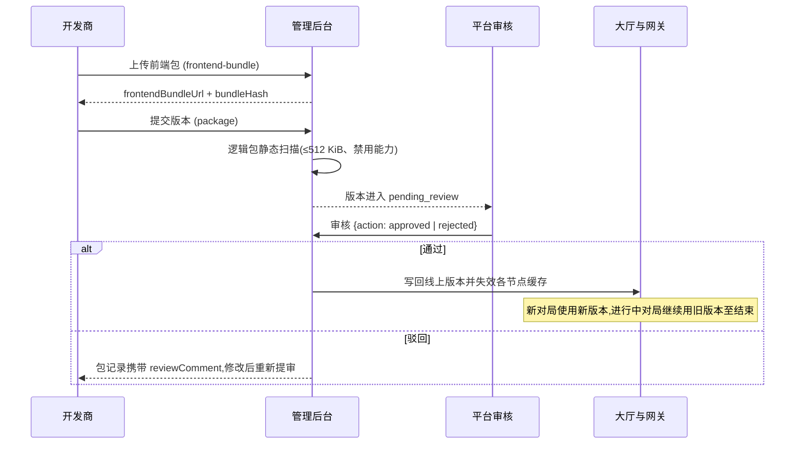

# 提交与审核

## 游戏包构成

一个可提审的游戏版本由两部分组成,可只更新其中之一:

| 组成 | 形式 | 上传方式 |
| --- | --- | --- |
| 前端包 | zip 压缩包,构建产物 | 先上传获得 URL,再随提审单提交 |
| 游戏逻辑包 | 单文件 JS bundle 全文 | 随提审单以字符串提交 |

前端包硬性要求:

- zip 原始大小不超过 25 MB,解压后总大小不超过 75 MB,文件数不超过 2000。
- 必须在 zip 根目录包含 index.html 入口文件。
- 必须为纯静态资源,不依赖任何服务端能力。SPA 路由请使用 hash 模式。

游戏逻辑包硬性要求见[游戏逻辑开发](game-backend.md)的运行约束一节。

## 上传前端包

```text
POST /api/admin/game/:id/frontend-bundle
Content-Type: multipart/form-data

version: 1.0.0
file: dist.zip
```

响应:

```json
{
  "frontendBundleUrl": "https://example.com/frontend/<gameId>/1.0.0/<uuid>/index.html",
  "bundleHash": "<zip 字节的 SHA-256 十六进制串>"
}
```

bundleHash 与 URL 需要在提审单中原样带回,作为该版本内容的存证。

## 提交审核

```text
POST /api/admin/game/:id/package
```

```json
{
  "version": "1.0.0",
  "frontendBundleUrl": "https://example.com/…",
  "bundleHash": "…",
  "backendJsBundle": "…",
  "rtpDeclared": 95.00,
  "rakeRateDeclared": 2.00
}
```

| 字段 | 说明 |
| --- | --- |
| version | 必填,1–50 字符,建议语义化版本 |
| frontendBundleUrl | 首次提审必填,更新时留空表示沿用上一版本 |
| bundleHash | 与前端包对应 |
| backendJsBundle | bundle 全文,首次提审必填,更新时留空表示沿用上一版本 |
| rtpDeclared | 选填,期望回报率,两位小数,如 96.50。依赖随机结果的玩法应申报,平台据此做漂移核查 |
| rakeRateDeclared | 选填,平台抽成,两位小数,如 2.00 |

除接口外,也可登录开发商后台在游戏版本页以表单提交:前端包与逻辑包均支持"继承上一版本 / 上传文件 / 手动填写 URL"三种方式,表单内同屏填写申报参数。

增量提交规则:

- 首次提审必须同时包含前端包与游戏逻辑包。
- 后续版本可只提交变更的一侧,未提交侧自动继承上一已提交版本,并在包记录中标注来源版本,便于审核聚焦变更内容。
- 两侧均未变更的提交会被拒绝,错误码 400332。

提交后版本进入 pending_review,响应为完整包记录,含包 ID、状态与继承标记,可通过 `GET /api/admin/game/:id/package` 查询全部历史版本。RTP 申报的核查规则见[资金接入](funds.md)。

## 审核范围

| 审核项 | 说明 |
| --- | --- |
| 安全 | 游戏逻辑包静态扫描禁用能力,前端包解压安全,防范路径穿越与压缩炸弹 |
| 合规 | 无外联、无第三方广告与支付、无诱导跳转,玩法参数申报合理 |
| 资金 | 回合模型使用正确,无绕过回合的资金操作,失败分支处理完整 |
| 体验 | 断线重连、状态同步、离席处理、错误提示完整可用 |
| 联机 | 人数配置与会话模式同玩法匹配,匹配参数合理 |

首个版本审核通过后立即自动发布,游戏转为 approved 并出现在大厅,无需另行上架操作。审核意见与驳回原因在包记录的 reviewComment 字段返回。



## 版本更新与回滚

- **更新**:重复上传与提审流程,审核通过即全量替换线上版本。进行中的对局继续使用旧版本直至结束,新对局使用新版本。
- **回滚**:任一已过审版本可随时切换回线上,接口为 `POST /api/admin/game/:id/package/:pid/switch`,目标包须为 approved 状态。游戏归档状态下不允许切换版本。

## 平台侧发布脚本

平台运营代开发商发布时,可用平台侧脚本一键完成上传、提审与过审发布:

```bash
ADMIN_API=https://game.zihua-chen.cn ADMIN_USER=admin ADMIN_PASS=… \
  ./scripts/publish-game.sh <gameId> <version> <前端dist目录> <backend/dist/game.js> [rtp] [rake]
```

开发商账号无审核权限,日常请走后台表单提审,也可按上述接口以脚本方式完成。注意过审即发布,逻辑包必须随包重提,只传前端包的版本不会更新服务端逻辑。
