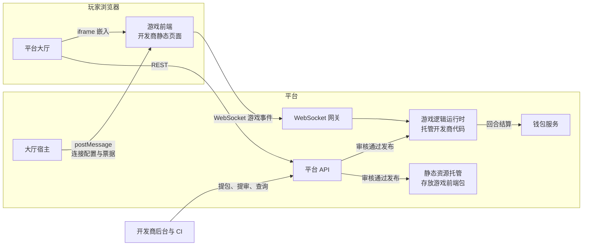

# 系统架构

## 服务组成

| 组件 | 说明 |
| --- | --- |
| 玩家大厅 | Vue 3 单页应用,提供游戏列表、搜索、收藏、游戏宿主、钱包与个人中心 |
| 管理后台 | Vue 3 单页应用,承载平台运营与开发商后台 |
| Admin API | 后台服务,负责管理员与开发商账号、游戏与版本审核、财务、内容运营 |
| Lobby API | 大厅服务,负责玩家注册登录、游戏列表、钱包、签到任务、通知与充值 |
| Game API | WebSocket 网关与游戏逻辑运行时,负责会话状态机、匹配、回合结算与公平随机 |
| PostgreSQL / Redis | 关系存储与缓存,Redis 同时承载实时余额推送 |
| 对象存储 | S3 兼容存储,托管审核通过的游戏前端包 |

## 身份体系

平台区分三类账号。玩家由大厅自助注册,注册即创建玩家账户与钱包,凭玩家令牌访问大厅与游戏服务。管理后台用户与玩家分属两个独立身份域,RBAC 权限体系只约束后台用户。开发商是后台侧账号,只能操作本开发商名下的游戏。

## 游戏托管模型

一款游戏由游戏前端与游戏逻辑两部分组成,均由开发商开发、平台托管运行。

- **游戏前端**是标准 Web 静态资源,以 iframe 方式嵌入大厅页面运行。
- **游戏逻辑**是一份 JavaScript 程序,提交到平台后由隔离运行时托管执行,负责全部权威玩法逻辑与结算。游戏逻辑不暴露任何网络接口,玩家无法绕过前端直接访问。

设计原则:

1. **凭证不进游戏前端**:游戏前端运行在不授予 `allow-same-origin` 的 iframe 沙箱中,通过宿主协议向大厅索取一次性 WebSocket 票据;票据单次有效、30 秒过期,玩家长期凭证不会离开大厅。宿主按消息来源窗口校验 opaque-origin postMessage,Game API 仅在配置了游戏包来源时接受对应的 `Origin: null` WebSocket。
2. **权威在服务端**:影响玩法与资金的操作均由平台托管的游戏逻辑裁决,前端只负责表现。
3. **资金平台托管**:游戏逻辑只能通过平台回合接口发起扣款与奖励,结算原子完成并全程留痕。

## 对局链路

- 会话状态机为 `created → waiting → ready → playing → finished`,error 与 timeout 为终态,玩法动作仅在 playing 状态受理。
- quick 模式由匹配器按游戏自动池化玩家,人数达到 minPlayer 即自动开局。
- room 模式通过 REST 创建房间并获得 6 位房间码,其他玩家凭码加入等待室,房主满足人数后开局。
- 观战为会话级只读连接,需游戏声明允许。

## 资金链路

玩家钱包由余额与流水两部分组成,一切资金变动包裹在显式回合中,整回合原子提交、失败整体回滚。余额变更在事务提交后经 Redis 发布订阅广播,由网关实时推送到玩家的全部连接,游戏内余额显示无需轮询。充值遵循实名认证、下单、渠道回调、同事务入账的闭环,幂等键防止重复入账。
